# Raman_forRecognition

拉曼光谱荧光背景扣除（基线校正）的复现与横向对比，基于 [pybaselines](https://github.com/derb12/pybaselines)。

拉曼光谱测量中，样品本身的荧光会产生一条缓慢变化的背景，把窄的拉曼峰抬高、甚至淹没。这个项目用 pybaselines 提供的多种算法把这条背景估计出来并减掉，同时在同一份数据上横向比较六种方法的差异。

> 📄 **完整实验报告：[拉曼光谱细菌鉴定的实验研究](docs/raman-classification-report.md)**
> —— 七轮实验（P2–P7）、六组负结果与一次方法学修正。结论：跨批次上
> 「SNV + 全维 + 线性 SVM 已是强基线（细菌 0.828 / 油脂 0.898）」；
> 拒识上「可行性由未知类的几何位置决定（AUROC 0.10–0.96），不由评分器决定」。


## 这个项目做了什么

| 脚本 | 作用 |
|---|---|
| `01_quickstart.py` | 用合成光谱（4 个高斯峰 + 指数/二次背景 + 噪声）复现 ModPoly 与 IModPoly，并计算基线误差 |
| `02_process_my_csv.py` | 读取自己准备的两列 CSV，用 IModPoly 做校正，输出结果谱与图 |
| `compare_baseline_methods.py` | 在同一个光谱上同时运行 **6 种方法**，对比基线形状、校正谱与误差 |

## 快速开始

```bash
# 1. 准备环境
python -m venv .venv
.venv\Scripts\activate          # Windows
pip install -r requirements.txt

# 2. 运行模拟数据复现
python 01_quickstart.py

# 3. 处理自己的数据（需先放 my_raman.csv 在同目录）
python 02_process_my_csv.py

# 4. 六种方法横向对比
python compare_baseline_methods.py
python compare_baseline_methods.py --csv my_raman.csv
```

## 命令行用法

`cli.py` 是面向日常使用的统一入口（`01_*.py`～`10_*.py` 则是实验复现脚本）：

```bash
# 查看数据集概览（类别分布、点数、位移范围）
python cli.py info --dataset bacterial

# 校正一条自己的两列 CSV，输出 *_corrected.csv 与图
python cli.py preprocess my_raman.csv --method imodpoly --order 5

# 只做归一化、换方法、指定输出位置
python cli.py preprocess my_raman.csv --method airpls --normalize snv --out result.csv

# 跑一次分类基线，同时报随机划分与留一批次两种协议
python cli.py classify --dataset oil
```

```
随机分层划分 : 准确率 0.964 | 宏平均 F1 0.964
留一批次验证 : 平均 0.898 ± 0.119（7 折）
两者差距     : +0.066
```

## 单元测试

```bash
python -m unittest discover -s tests -v
```

23 个用例覆盖数据校验、归一化、寻峰、CSV 编码容错、基线校正、增强、原型分类与开放集评分。
其中 `test_too_typical_unknown_is_undetectable` 直接复现了正文 P7 的核心发现：
把未知样本取成类中心时，它比真实已知样本更"典型"，AUROC 降到 0.5 以下。

## 输入数据格式

两列 CSV，第一列拉曼位移（cm⁻¹），第二列强度，**第一行为表头**：

```csv
raman_shift_cm-1,intensity
200,1250
201,1252
202,1260
```

## 数据集

项目使用 **Zenodo 15279321** 的公开拉曼数据集（CC-BY-4.0），包含两个子集：

| 子集 | 内容 | 样本数 | 类别 | 点数 | 特点 |
|---|---|---|---|---|---|
| `Bacterial_data` | 单个细菌细胞 | 2710 | 6 种菌 | 1376 | 含 **9 个测量批次**，适合做跨批次泛化 |
| `Oil_data` | 食用油脂 | 560 | 8 种油 | 916 | 官方已划分 train 320 / test 240 |

下载方式（脚本已封装好，直接跑）：

```bash
mkdir -p data/raw && cd data/raw
curl -L -O https://zenodo.org/api/records/15279321/files/Bacterial_data.zip
curl -L -O https://zenodo.org/api/records/15279321/files/Oil_data.zip
cd ../.. && python -c "import zipfile; [zipfile.ZipFile(f'data/raw/{n}').extractall('data') for n in ('Bacterial_data.zip','Oil_data.zip')]"
```

解压后目录为 `data/Bacterial_data/` 与 `data/Oil_data/`，验证：

```bash
python 03_load_dataset.py
```

> **注意**：这两个数据集的 CSV 是"矩阵式"（第一行是位移轴，之后每行一条光谱），不是常见的两列格式，必须用 `raman_rec.load_bacterial()` / `load_oil()` 读取，不能用 `load_csv()`。

**引用（CC-BY-4.0 要求署名）**：

> Guo, S. *Raman spectral datasets from single bacterial cells and different oil*. Zenodo (2025). doi:10.5281/zenodo.15279321

## 识别实验结果

流水线：SNV 归一化 → StandardScaler → PCA(20) → 线性 SVM。两种评估协议对比：

| 数据集 | 随机划分 | 留一批次验证 | 差距 |
|---|---|---|---|
| bacterial（6 类菌，2710 条） | **0.904** | **0.778 ± 0.052** | **+0.126** |
| oil（8 类油，560 条） | **0.982** | **0.891 ± 0.118** | **+0.091** |


**这是本项目目前最值得关注的一组数字。** 随机划分看起来接近完美，但换成"留出一整个测量批次做测试"，
准确率就掉了 9–13 个百分点。说明模型学到的特征里有相当一部分是"这一批测量长什么样"（批次偏移），
而不是"这是什么物质"。

混淆矩阵还显示，细菌集的错误高度集中在 **E-coli ↔ R-terrigena** 这一对近缘种上（互相误判 31 条与 15 条），
其余四类的识别率都在 95% 以上。近缘种分离、跨批次泛化，是两个真实的开放问题。

复现：

```bash
python 04_classify.py --no-show                    # 两个数据集都跑
python 04_classify.py --dataset oil --classifier lda
```

> **方法学修正（2026-11-19）**：后续维度扫描发现，本节固定使用的 PCA=20 在细菌集上是次优取值。
> 不降维时基线为 **随机 0.932 / 留批次 0.828**（差距 10.4 pt），下表数据请结合
> 下文「维度扫描」一节阅读。

## 批次校正实验（负结果）

> 详细技术报告（含逐方法失效机制、局限说明、可引用结论）：
> **[docs/batch-correction-negative-result.md](docs/batch-correction-negative-result.md)**

针对上面的 9–13 点差距，测试了三种**无需标签**的批次校正手段，结果**全部无效**：

| 预处理 | bacterial 留批次 | 相对 SNV | oil 留批次 | 相对 SNV |
|---|---|---|---|---|
| raw（不处理） | 0.759 | −1.9 pt | 0.763 | −12.9 pt |
| **SNV（基线）** | **0.778** | — | **0.891** | — |
| SNV + 一阶导数 | 0.642 | **−13.6 pt** | 0.861 | −3.0 pt |
| SNV + 批次中心化 | 0.784 | +0.6 pt | 0.857 | −3.4 pt |
| SNV + CORAL 对齐 | 0.698 | **−8.1 pt** | 0.863 | −2.9 pt |
| SNV + 指纹区(500–1800) | 0.748 | −3.0 pt | 0.882 | −0.9 pt |

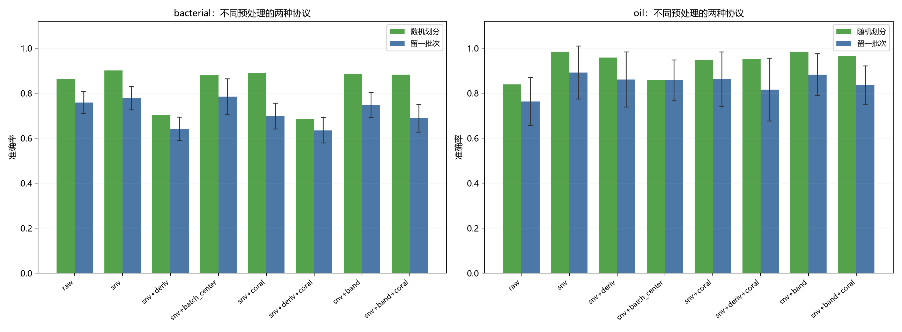

**唯一正增益（+0.6 pt）小于一个标准差（±7.9 pt），不构成有效提升。**

原因分析：SNV 逐条减均值除以标准差，恰好抵消了跨批次最易变化的加性偏移与乘性缩放；
剩下的差异是峰位微移、峰宽变化等非线性成分，线性变换处理不了。导数放大噪声、
批次中心化连带减掉类别共性、CORAL 的单源域假设在多批次训练集上不成立。

详细分析见 `docs/batch-correction-negative-result.md`（技术报告）与
`experiments/2026-11-19-p3-batch-correction.md`（实验记录）。**这个负结果本身有价值**：
它说明浅层预处理已到瓶颈，提升必须来自数据驱动的不变性（增强 / 域对抗）或度量学习。

```bash
python 05_batch_effect.py --no-show
```

## 数据增强实验（仍无显著提升）

既然"改输入"失败，第二轮改为**训练期增强**：只加能改变形状的扰动（背景形状、波数平移、模糊、噪声），
在训练集上制造"看起来像别的批次"的样本。

> ⚠️ 一个容易踩的坑：加偏移、调增益在 SNV 之后**完全不可见**（SNV 会把它们一并消掉），
> 这样增强等于没做。这是光谱数据增强最常见的误区。

（下表为不降维条件下的结果，与 P5 修正后的基线一致）

| 配置 | bacterial 留批次 | oil 留批次 |
|---|---|---|
| 无增强（基线） | **0.828 ± 0.066** | **0.898 ± 0.119** |
| 增强×2 | 0.815 | 0.920 |
| 增强×4 | 0.820 | 0.920 |
| 仅背景形状×4 | 0.814 | 0.921 |
| 仅平移×4 | 0.834 | 0.879 |

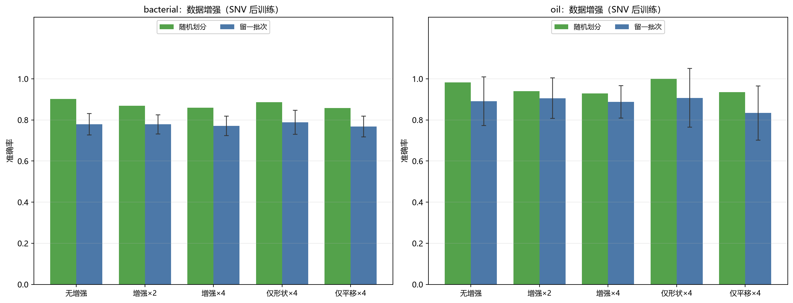

细菌集上全部为负（−0.8 至 −1.3 pt），油脂集最大 +2.3 pt（标准差 0.13，仍在噪声内）。
**而且这些增益的正负号会随降维设置翻转**（PCA=20 时"仅形状"为正、"仅平移"为负，全维时相反），
说明 1–2 个百分点的差异本质上是噪声，不是方法效应。

详细分析见 `experiments/2026-11-19-p4-augmentation.md`。连续两轮失败的共同结论：
**批次效应需要被显式建模，而不是被随机化掉。**

## 维度扫描：一次方法学修正

原型分类实验（`prototype_result.png`）证明**换分类器没用**——欧氏/余弦/白化原型全面劣于 SVM
（细菌 −9 至 −11 pt），说明各类在特征空间里并非紧凑球状，瓶颈不在决策边界。

顺着这条线做维度敏感性检查，发现了一个更根本的问题：**此前所有实验固定 PCA=20，这个选择本身压低了性能。**

| PCA 维数（bacterial） | 随机划分 | 留一批次 |
|---|---|---|
| 10 | 0.853 | 0.758 |
| 20（此前基线） | 0.901 | 0.778 |
| 50 | 0.885 | 0.795 |
| 200 | 0.911 | 0.804 |
| **不降维** | **0.932** | **0.828** |

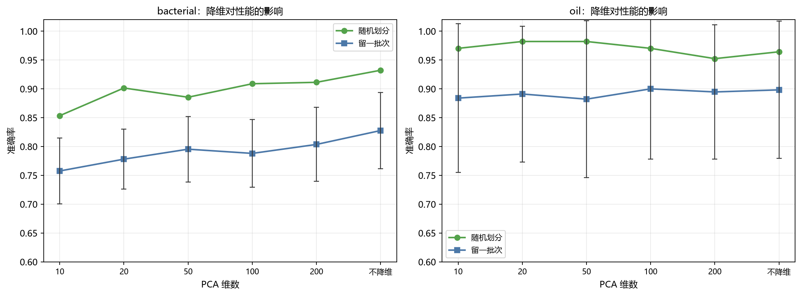

三点结论：

1. **细菌集上 PCA 是负收益**，维度越高越好；**油脂集几乎不受影响**（0.882–0.900）。
   原因是 6 类近缘菌的判别信息分散在大量弱峰上，降维时被优先丢弃；而 8 类油靠少数强峰
   （C–H 伸缩）就能分开，20 维已足够。
2. **修正后的基线是 0.932 / 0.828**，批次差距从 12.6 pt 收窄到 10.4 pt，但问题依然存在。
3. **P3 的负结论在全维下依然成立**：波段筛选 0.828→0.802、导数 0.828→0.737，
   只有批次中心化 +0.6 pt（在标准差内）。

> 方法学教训：当所有实验都固定在同一超参上时，验证的其实是"这个超参下的结论"，
> 而不是结论本身。详见 `experiments/2026-11-19-p5-prototype-and-dimension.md`。

```bash
python 07_prototype.py --no-show      # 原型分类 vs SVM
python 08_dimension_sweep.py --no-show # 维度扫描 + 全维复检
```

## 度量学习实验（仍不及基线）

既然原型法失败，推断原因是"类内不够紧凑"，于是先学一个让类内紧凑的度量（LDA）再分类。

| 配置 | bacterial 留批次 | oil 留批次 |
|---|---|---|
| **SVM（基线）** | **0.828 ± 0.066** | **0.898 ± 0.119** |
| LDA + SVM | 0.684 ± 0.097 | 0.832 ± 0.079 |
| **LDA（收缩）+ SVM** | **0.818 ± 0.078** | **0.893 ± 0.121** |
| LDA + 原型 | 0.704 ± 0.094 | 0.830 ± 0.088 |
| LDA + kNN | 0.700 ± 0.093 | 0.836 ± 0.093 |

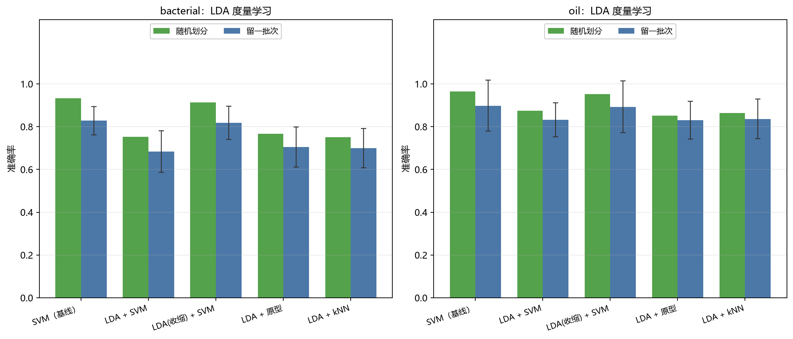

**LDA 一开始是灾难性的**——随机划分从 0.932 掉到 0.752。原因是 1376 维、1898 样本下
类内散度矩阵严重病态，投影被估计噪声主导。改用 **Ledoit-Wolf 收缩估计**后恢复到 0.818
（油脂 0.832→0.893），几乎追平基线——**这证明失败是协方差估计问题，不是方向错误**。

但恢复之后仍然**不超过**朴素基线。线性度量学习这条路同样走不通。

> 阶段性结论：**SNV + 全维 + 线性 SVM 已经是一个很难逾越的强基线。**
> 换分类器（原型/kNN）、改输入（导数/CORAL/波段）、加随机增强、学线性度量，
> 四类尝试全部无效。进一步的提升需要非线性表征学习，或更多批次的数据。

## 开放集实验：模型能否识别"没见过的东西"

前面的实验都在问"分得准不准"，这一轮问另一个问题：**遇到训练时没见过的物质，模型会不会硬猜？**

留一类法：每次把 1 类整体排除在训练外当作"未知物"，测试时已知与未知混在一起。

| 评分器 | bacterial 留批次 AUROC | oil 留批次 AUROC |
|---|---|---|
| SVM 决策值 | 0.591 | 0.415 |
| 原型距离 | 0.543 | 0.668 |
| 马氏距离 | 0.519 | 0.647 |

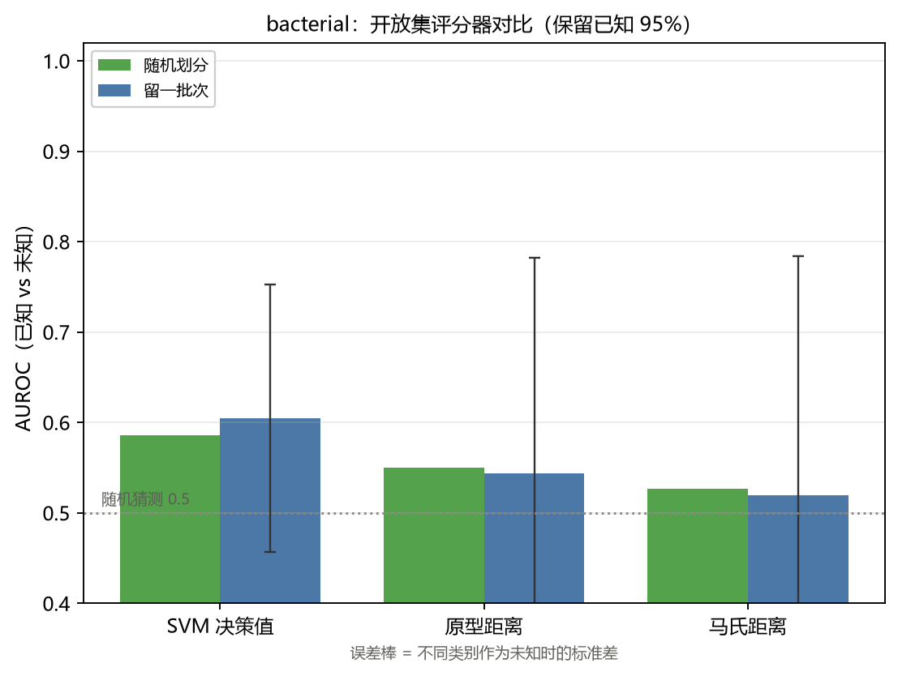

**平均 AUROC 只有 0.52–0.67，勉强高于随机猜测。** 但真正值得注意的是分类别的差异：

| 未知类（马氏距离） | AUROC | | 未知类 | AUROC |
|---|---|---|---|---|
| P-stutzeri | **0.96** | | S-cohnii | 0.46 |
| L-innocua | 0.69 | | E-coli | 0.44 |
| R-terrigena | 0.47 | | S-warneri | **0.10** |

**同一套评分器，对 P-stutzeri 能到 0.96，对 S-warneri 只有 0.10。** 标准差 0.26，比均值还大。

原因是距离类方法的前提——"未知物离已知类远"——在近缘物种上不成立：
S-warneri 谱形结构较弱、更接近所有菌种的平均，经标准化后落在特征空间的**中心区域**，
而中心恰恰离所有类中心都近。**越"平庸"的未知物越难被拒识**，这是异常检测的经典困境。

详细分析见 `experiments/2026-11-19-p7-openset.md`（含两个实现 bug 的排查过程）。

## 非线性模型实验（P8，仍未突破）

前七轮都在线性框架内。最后一轮换非线性模型，回答"瓶颈是表达力还是数据"。

| 数据集 | 模型 | 随机划分 | 留一批次 | 相对基线 |
|---|---|---|---|---|
| bacterial | **线性 SVM（基线）** | 0.932 | **0.828** | — |
| bacterial | MLP（128 隐单元） | 0.935 | 0.834 ± 0.069 | +0.6（噪声内） |
| bacterial | 1D-CNN | 0.819 | 0.751 ± 0.039 | −7.7 |
| oil | **线性 SVM（基线）** | 0.964 | **0.898** | — |
| oil | MLP | 0.899 | 0.814 ± 0.103 | −8.4 |
| oil | 1D-CNN | 0.917 | 0.830 ± 0.103 | −6.8 |

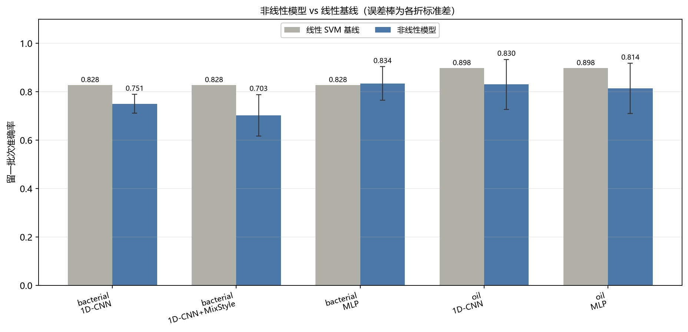

**非线性没有带来提升。** 更重要的是诊断结果：CNN 的训练损失能降到 **0.001**，
测试却只有 0.68——模型容量绰绰有余，缺的是**能覆盖变异的数据**。
10 万参数配 2400 个样本，任何强表达力模型都会优先记住样本而非学习规律。

> 这也解释了为什么线性 SVM 这么难超越：在 1376 维上它等价于"模板匹配"，
> 而这个假设恰好匹配拉曼光谱的物理结构（每种物质有一组特征峰位）。

MixStyle 域泛化尝试为负增益（留批次 0.751→0.703），属实现未调优，详见
`experiments/2026-11-19-p8-neural.md`。

> ⚠️ 运行 `11_neural.py` 需额外安装 PyTorch：
> `pip install torch --index-url https://download.pytorch.org/whl/cpu`（约 200 MB）

## 六种方法的对比结果

合成光谱（1600 点，噪声标准差 5.0，真实背景已知）：

| 方法 | 最优参数 | 基线 RMSE |
|---|---|---|
| `imodpoly` | poly_order=5 | **0.727** |
| `mixture_model` | p=0.7 | 0.945 |
| `airpls` | lam=1e6 | 6.217 |
| `pspline_asls` | lam=1000, p=0.05 | 6.832 |
| `asls` | lam=1e6, p=0.05 | 7.000 |
| `snip` | max_half_window=40 | 9.301 |

> 共选取 6 个有代表性的方法。pybaselines 一维方法实际有 60 余个。

## 三个必须注意的结论

1. **RMSE 排名不等于方法优劣。** 这条合成谱的真实背景接近低阶多项式，所以 `imodpoly` 占优有数据配合的成分。真实样品的荧光形状往往不是多项式，`asls`、`airpls` 可能更稳。

2. **参数影响大于方法选择。** 同一个 `imodpoly`，`poly_order=2` 时 RMSE 约 13.8，`poly_order=5` 时是 0.727。换算法之前先调参。

3. **真实数据没有真值，不能用 RMSE 自动选参。** 合成数据的"自动挑最优参数"是它独有的特权。真实数据只能靠峰形是否被削、负值比例、重复谱一致性来判断。

## 谱库匹配实验：建库 + 比对能到多少（P11）

实际做分子识别，常见做法不是训练分类器，而是**建谱库 + 比对**：每种物质存几条代表谱，
待测谱与库逐条比相似度，取最高的一条，相似度太低就报"库中没有"。这条路的可行性：

| 每类库谱 | 闭集准确率 | 库外拒识率 | 开放集准确率 | AUROC |
|---|---|---|---|---|
| 1（类均值） | **0.792** | 0.151 | **0.503** | 0.572 |
| 3 | 0.686 | 0.147 | 0.449 | 0.563 |
| 10 | 0.676 | 0.154 | 0.442 | 0.558 |
| 留一批次（3 条） | 0.684 | 0.147 | 0.556 | 0.540 |

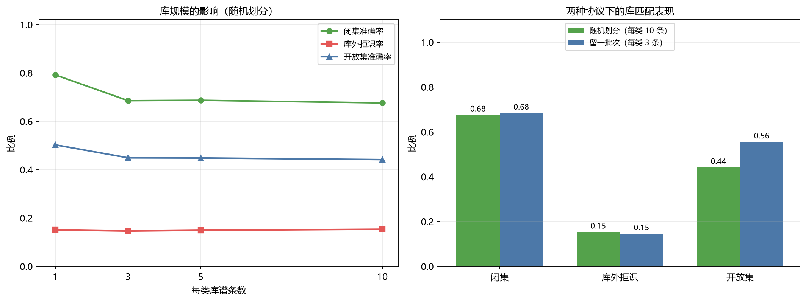

三个发现：

1. **朴素库匹配远不如训练分类器**：闭集 0.68–0.79，同一批数据上线性 SVM 是 0.93。
   相关性把全部特征等权，而判别信息集中在少数弱峰上。
2. **库谱越多反而越差**：1 条 0.792 → 3 条 0.686 → 10 条 0.676。取 `max` 相似度时，
   条目越多，错误类别里"恰好撞高分"的机会越大。**"库越大越好"是错觉**。
3. **拒识几乎失效**：AUROC 0.51–0.57，接近随机。与 P7 一致——库外样本能否被拦，
   取决于它离库多远，而不是阈值定得多好。

一阶导数相关全面更差（闭集最低 0.35），原因同 P3：单细胞光谱微分会放大噪声。

> 这是最朴素的实现（相关 + 全局阈值）。要提升必须补三件事：**峰位对齐、局部加权匹配、
> 分类别接受域**。详见 `experiments/2026-11-19-p11-library-match.md`。

```bash
python 13_library_match.py --sim raw --no-show     # 原始谱相关
python 13_library_match.py --sim deriv --no-show   # 导数相关
```

### 改进版：补上峰位对齐、Fisher 加权、分类别阈值

| 变体 | 协议 | 闭集 | 库外拒识 | 开放集 | AUROC |
|---|---|---|---|---|---|
| 朴素 | 随机 | 0.686 | 0.147 | 0.449 | 0.563 |
| 朴素 | 留批次 | 0.684 | 0.147 | 0.556 | 0.540 |
| 改进 | 随机 | **0.728** | **0.303** | **0.540** | 0.573 |
| 改进 | 留批次 | 0.659 | **0.290** | 0.560 | 0.553 |

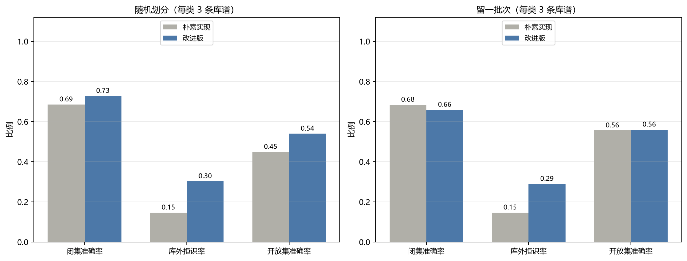

**拒识率翻倍，但 AUROC 几乎没动（0.563→0.573）。** 这说明提升几乎全部来自阈值变严，
而不是"库内与库外变得更可分"——留批次下闭集准确率反而从 0.684 掉到 0.659。

> 这是评估这类改进时最容易骗过自己的地方：只看开放集准确率会以为方法变好了，
> 把 AUROC 单列出来才看得出真正的可分性没变。详见 `experiments/2026-11-19-p11b-library-v2.md`。

**换到油脂集（8 类食用油），结论完全不同：**

| | 细菌（6 类近缘种） | 油脂（8 类食用油） |
|---|---|---|
| 闭集准确率（改进） | 0.728 | **0.941** |
| AUROC（改进） | 0.573 | **0.848** |
| 可用性判断 | 几乎不可分 | 基本可分 |

八种油在碳氢伸缩区（约 2900 cm⁻¹）就有明显分组差异，整谱相关足以应付；
六种近缘菌的差异分散在大量弱峰上，等权相关抓不住。
**库匹配的可行性与"类别差异大小"强相关，不是算法本身好坏的问题。**

```bash
python 14_library_match_v2.py --dataset bacterial --no-show
python 14_library_match_v2.py --dataset oil --no-show
```

## 级联方案：库匹配做门控 + 分类器做判定（P12）

库匹配擅长"像不像库里的东西"、SVM 擅长"库内该判哪类"，把两者串起来：
**门控先筛（不像就判库外），通过的再交给 SVM 定类。**

| 数据集 | 协议 | 纯分类器 | 纯库匹配 | 级联 | 门控放行/拒识 |
|---|---|---|---|---|---|
| 细菌 | 随机 | 0.569 | 0.513 | **0.622** | 0.95 / 0.20 |
| 细菌 | 留批次 | **0.721** | 0.567 | 0.707 | 0.95 / 0.15 |
| 油脂 | 随机 | 0.670 | 0.869 | **0.881** | 0.94 / 0.77 |
| 油脂 | 留批次 | **0.801** | 0.699 | 0.732 | 0.73 / 0.77 |

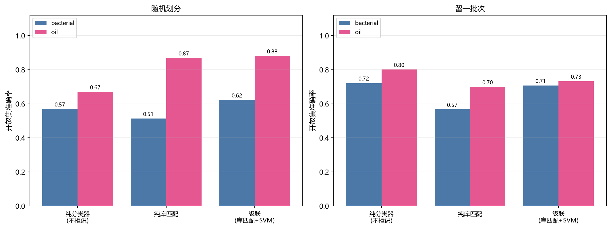

**随机协议下级联最优，留批次下纯分类器最优。** 分水岭是门控的误拒率：
同一套阈值，随机协议放行 94%，留批次只放行 73%。

原因是拒识的收益有**硬上限**——未知类只占测试样本的 1/N，完美门控最多加 1/N（细菌 16.7 pt、
油脂 12.5 pt），而误拒的代价作用在 (N−1)/N 的样本上。油脂留批次实测：
收益 +9.6 pt、代价 −24.8 pt，净 −15 pt，正好对应 0.801 → 0.732。

> 要让级联真正立住，必须解决阈值跨批次失配（分组标定 / 相对阈值 / 二段式筛选）。
> 详见 `experiments/2026-11-19-p12-cascade.md`。

```bash
python 15_cascade.py --keep-rate 0.995 --no-show
```

## 稳定性与归因：把"运气"和"难度"分开（P13/P14）

前面所有结果都只跑了一次随机划分，容易被问三件事：0.932 是不是抽到了好划分？
两类为什么会混？0.828 在文献里算什么水平？

### 划分运气 vs 批次难度

| 配置 | 随机划分（5 种子） | 留一批次（9 折） |
|---|---|---|
| 全维 | **0.926 ± 0.009** | **0.828 ± 0.066** |
| PCA=20 | 0.897 ± 0.007 | 0.778 ± 0.052 |
| 指纹区 | 0.906 ± 0.008 | 0.800 ± 0.062 |

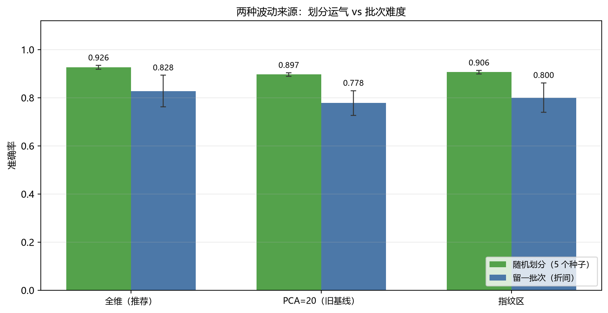

**种子波动 0.9 个百分点，折间波动 6.6 个百分点，差 7 倍。** 主导波动来源是批次难度，
"抽到好划分"的质疑可以排除。

### 模型靠哪几段谱在判断

E-coli vs R-terrigena 的判别权重集中在 **452、864、1024、1162、1206、1652、2856、2914 cm⁻¹**——
C–H 伸缩（膜脂）、酰胺 I（蛋白）、多糖与磷酸二酯（细胞壁/核酸），生物学上说得通。

打乱波段测重要性：**800 cm⁻¹（−15.0 pt）与 2864 cm⁻¹（−12.1 pt）贡献了近一半判别信息**，
且关键波段**碎片化分布**——这正是 P3 中"波段筛选反而掉点"的原因。

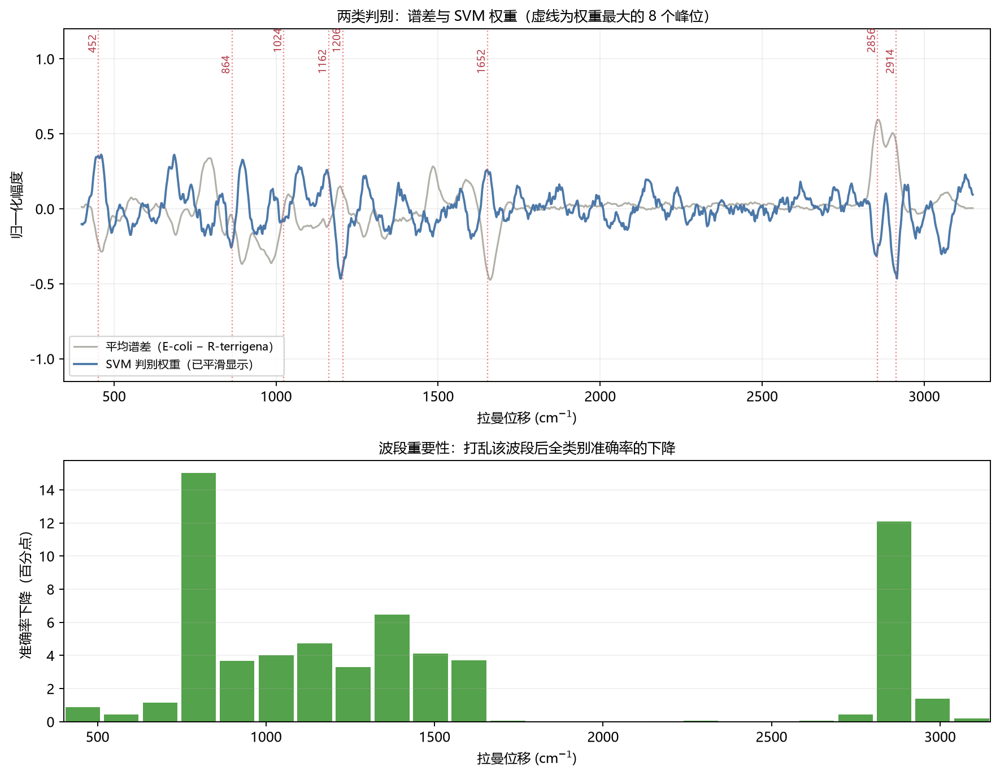

### 与文献对齐

同期工作（ISME J 2025，36 株菌）报告闭集 96.1%、纯培养模型用于环境样品 **79%**。
本项目 0.926 / 0.828，量级一致，且"跨条件掉 10–20 个百分点"是该任务的固有代价，
不是本项目的缺陷。

```bash
python 16_seed_stability.py --no-show
python 17_attribution.py --no-show
```

## 无真值选参实验（P10，结论：能力有限）

真实光谱没有"正确背景"这个标准答案，误差算不出来。本轮设计四个**不需要真值**的代理指标
（负值比例、基线曲率、低频残差、噪声偏离），按"最差项决定得分"合成总分来选参。

**合成数据上的验证**（噪声 σ=5，真值已知，默认值取 `DEFAULT_PARAMS`）：

| 方法 | 默认参数误差 | 代理选参误差 | 真实最优 | 选中排名 |
|---|---|---|---|---|
| imodpoly | **0.727** | 0.814 | 0.727 | 2/7 |
| snip | **9.301** | 9.301 | 9.301 | 1/7 |
| airpls | **6.217** | 8.321 | 6.217 | 2/5 |
| modpoly | 5.140 | 5.188 | 4.528 | 3/7 |
| asls | 8.411 | 8.411 | 7.000 | 4/20 |
| pspline_asls | 7.577 | 15.459 | 6.832 | 6/15 |

全部 67 个候选合并后，综合得分与真实误差的 Spearman 秩相关 **ρ = −0.74**，
代理指标确实能排序。**但默认参数本身就落在最优点附近**——imodpoly、airpls、snip
的默认值就是网格最优值，代理选参在其中两个上反而更差。

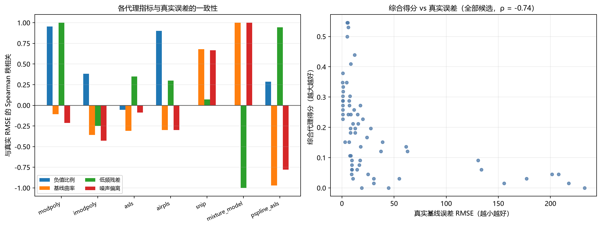

**把噪声提高 4 倍（σ=20）后方法明显失效**：七个方法中四个的秩相关掉到 0 附近，
asls 甚至变成 +0.03。而高噪声恰恰是真实单细胞光谱的常态。

**真实数据上的下游效果**（留一批次协议）：

| 方法 | 默认参数 | 准确率 | 代理选参 | 准确率 | 变化 |
|---|---|---|---|---|---|
| imodpoly | poly_order=5 | 0.841 ± 0.070 | poly_order=4 | 0.840 ± 0.068 | −0.002 |
| asls | lam=1e6, p=0.01 | 0.842 ± 0.069 | lam=1e8, p=0.01 | 0.845 ± 0.069 | +0.003 |

两个方法都没有可见差异。

> **结论修正**：原设想的"无真值自动选参"实际价值有限——不是方法不成立（σ=5 时 ρ=−0.74），
> 而是**默认参数已经够好**，且方法在高噪声下失效。因此更合适的定位是
> **"校正质量诊断"**：用代理指标筛出被扣坏的谱交给人工复核，而不是替代默认参数。
> 详见 `experiments/2026-11-19-p10-param-selection.md`。

```bash
python 12_param_selection.py                                 # σ=5 合成验证
python 12_param_selection.py --noise 20                       # 噪声鲁棒性
python 12_param_selection.py --stage apply --method asls      # 下游验证
```

## 目录结构

```
Raman_forRecognition/
├── raman_rec/                    # 核心代码包（P0 重构后新增）
│   ├── spectrum.py               #   Spectrum 数据结构：归一化/平滑/寻峰/信噪比
│   ├── preprocess.py             #   七种基线方法的统一入口 + 参数网格
│   ├── io.py                     #   两列 CSV 读写（自动处理 GBK/UTF-8 与表头）
│   ├── synthetic.py              #   带真值的合成光谱生成器
│   ├── datasets.py               #   真实数据集加载器（细菌 / 油脂）与划分策略
│   ├── classify.py               #   特征构造、PCA+分类器流水线、两种评估协议
│   ├── transfer.py               #   批次校正：导数 / 批次中心化 / CORAL 域对齐
│   ├── augment.py                #   训练期增强：背景形状 / 平移 / 模糊 / 噪声
│   ├── prototype.py              #   原型分类器：欧氏 / 余弦 / 白化
│   ├── openset.py                #   开放集评分：margin / 原型距离 / 马氏距离
│   ├── library.py                #   谱库：代表谱选取 / 相关匹配 / 拒识阈值
│   └── paramselect.py            #   无真值选参：四个代理指标 + 最差项合成
├── cli.py                        # 命令行入口：info / preprocess / classify
├── 01_quickstart.py              # 演示：模拟数据 ModPoly vs IModPoly
├── 02_process_my_csv.py          # 实用：处理自备 CSV
├── 03_load_dataset.py            # 数据：加载真实数据集、打印概览、画各类平均谱
├── 04_classify.py                # 识别：PCA+SVM 分类，对比随机划分与留一批次
├── 05_batch_effect.py            # 校正：八种预处理 × 两种协议的批次效应实验
├── 06_augmentation.py            # 增强：训练期扰动 × 两种协议的增强实验
├── 07_prototype.py               # 分类器：原型 / kNN vs SVM
├── 08_dimension_sweep.py         # 维度：PCA 维数扫描 + 全维复检
├── 09_metric_learning.py         # 度量：LDA（含收缩）与分类器组合
├── 10_openset.py                 # 拒识：开放集识别（留一类作未知）
├── 11_neural.py                  # 非线性：MLP 与 1D-CNN（需 PyTorch）
├── 12_param_selection.py         # 选参：无真值代理指标验证与应用
├── 13_library_match.py           # 库匹配：建库 + 比对 + 拒识的可行性
├── 14_library_match_v2.py        # 库匹配改进版：对齐 + 加权 + 分类别阈值
├── 15_cascade.py                 # 级联：库匹配门控 + SVM 判定
├── 16_seed_stability.py          # 稳定性：多种子 vs 折间波动
├── 17_attribution.py             # 归因：判别权重与波段重要性
├── 18_improvement_summary.py     # 汇总：六类改进相对基线的变化（论文图 2）
├── 19_paired_test.py             # 配对检验：逐折 Wilcoxon 符号秩检验
├── compare_baseline_methods.py   # 对比：六种方法横向比较（支持 --csv）
├── experiments/README.md         # 实验记录规范与表格
├── tests/test_core.py            # 单元测试（unittest，23 个用例）
├── docs/                         # 技术报告
│   ├── raman-classification-report.md         # 完整实验报告（七轮实验总汇）
│   └── batch-correction-negative-result.md    # 批次校正负结果详细分析
├── my_raman.csv                  # 示例输入数据
├── quickstart_result.png         # 01 的输出图
├── my_raman_corrected.png        # 02 的输出图
├── compare_result.png            # 对比脚本的三联图
├── dataset_overview.png          # 03 的各类平均光谱图
├── classification_result.png     # 04 的混淆矩阵与各折准确率
├── batch_effect_result.png       # 05 的各预处理两种协议对比
├── augmentation_result.png       # 06 的增强配置两种协议对比
├── prototype_result.png          # 07 的分类器对比
├── dimension_sweep.png           # 08 的降维影响曲线
├── metric_learning_result.png    # 09 的度量学习对比
├── openset_result.png            # 10 的开放集评分器对比
├── neural_result.png             # 11 的非线性模型对比
├── param_selection_validate.png  # 12 的代理指标验证
├── library_match_result_raw.png  # 13 的库匹配结果
├── library_v2_result_bacterial.png # 14 的改进版对比（细菌）
├── library_v2_result_oil.png     # 14 的改进版对比（油脂）
├── cascade_result.png            # 15 的三种方案对比
├── seed_stability_bacterial.png  # 16 的稳定性对比
├── attribution_result.png        # 17 的波数归因
├── improvement_summary.png       # 18 的六类改进汇总
├── paired_test.png               # 19 的配对检验分布
├── data/                         # 数据集目录（不入库，见上文「数据集」）
├── 操作说明.txt                   # 中文操作手册
├── requirements.txt
└── .gitignore
```

其余 `*_corrected.csv`、`demo_raman.csv` 等中间产物可由脚本重新生成，已在 `.gitignore` 中排除。

## 核心 API

所有处理都以 `Spectrum` 为中心，每一步返回新对象，可以链式调用：

```python
from raman_rec import load_csv, remove_baseline

spec = load_csv("my_raman.csv")                 # 读数据，自动跳过表头、处理 GBK
spec = remove_baseline(spec, "imodpoly", poly_order=5)
spec = spec.smoothed(window=7).normalized("snv")  # 平滑 + 标准化

peaks = spec.peaks(prominence_frac=0.05)        # 寻峰
print(peaks["shift"][:5])                       # 前五个峰位
print("SNR:", spec.snr())
print("负值比例:", spec.negative_ratio())
```

可用基线方法：`modpoly` / `imodpoly` / `asls` / `airpls` / `snip` / `mixture_model` / `pspline_asls`。

## 开发路线

| 阶段 | 内容 | 状态 |
|---|---|---|
| P0 | 代码重构为包结构，统一数据与预处理入口 | ✅ 已完成 |
| P1 | 接入真实光谱数据集（Zenodo 15279321），统一格式与划分 | ✅ 已完成 |
| P2 | PCA + SVM 分类基线，跑通第一个识别准确率 | ✅ 已完成 |
| P3 | 批次效应校正实验（导数 / 批次中心化 / CORAL / 波段筛选） | ✅ 已完成（负结果） |
| P4 | 数据驱动的批次不变性：训练增强 | ✅ 已完成（无显著提升） |
| P5 | 分类器对比（原型/kNN）与维度敏感性修正 | ✅ 已完成（换分类器无效，发现 PCA=20 压低基线） |
| P6 | 全维复核增强 + 线性度量学习（LDA/收缩 LDA） | ✅ 已完成（均不及基线） |
| P7 | 开放集拒识（未知物识别）与置信度校准 | ✅ 已完成（平均 AUROC 仅 0.52–0.67，类别差异极大） |
| P8 | 非线性表征学习（MLP / 1D-CNN / MixStyle） | ✅ 已完成（未突破线性基线） |
| P9 | 工程化：CLI、单元测试、文档 | ✅ 已完成 |
| P10 | 无真值条件下的基线参数选择（代理指标） | ✅ 已完成（排序有效，下游收益可忽略） |
| P11 | 谱库匹配可行性（建库 + 比对 + 拒识） | ✅ 已完成（朴素实现明显弱于分类器） |
| P11b | 库匹配改进版（峰位对齐 + Fisher 加权 + 分类别阈值） | ✅ 已完成（拒识提升，可分性未变） |
| P12 | 级联方案（库匹配门控 + 分类器判定） | ✅ 已完成（随机最优，留批次不及纯分类器） |
| P13 | 稳定性分析（5 种子 × 3 配置） | ✅ 已完成（种子波动 0.9 pt，折间 6.6 pt） |
| P14 | 波数归因（判别权重 + 波段重要性） | ✅ 已完成（关键波段碎片化分布） |
| P15 | 六类改进汇总图（统一到全维协议） | ✅ 已完成（19 个配置中 15 个低于基线） |
| P16 | 配对检验（9 折 Wilcoxon） | ✅ 已完成（三类"提升"全部不显著） |

## 环境

- Python 3.13
- numpy 2.5 / scipy 1.18 / matplotlib 3.11
- pybaselines 1.2.x

## 常见问题

**`ImportError: DLL load failed ... 应用程序控制策略已阻止此文件`**

Windows 的应用控制策略（Smart App Control / WDAC）会拦截新下载的未签名编译扩展（`.pyd` / `.dll`），
典型表现是 `import sklearn` 或 `import pandas` 时报这个错。解除方法（PowerShell）：

```powershell
Get-ChildItem -Path ".venv\Lib\site-packages" -Recurse -File |
  Where-Object { $_.Extension -in ".dll",".pyd" } | Unblock-File
```

个别情况下需要对新安装的包里所有文件执行一次 `Unblock-File` 才能全部加载。

**`PermissionError: [Errno 13] ... .csv`**

文件正被 WPS / Excel 打开，Windows 下它们会对文件加独占锁。关掉软件再跑脚本即可。

## 参考与致谢

- [pybaselines](https://github.com/derb12/pybaselines) —— 基线校正算法库，BSD-3-Clause
- ModPoly / IModPoly 原始方法出自 Lieber & Mahadevan-Jansen (2003)

## 许可

本项目代码采用 MIT License，见 [LICENSE](LICENSE)。
