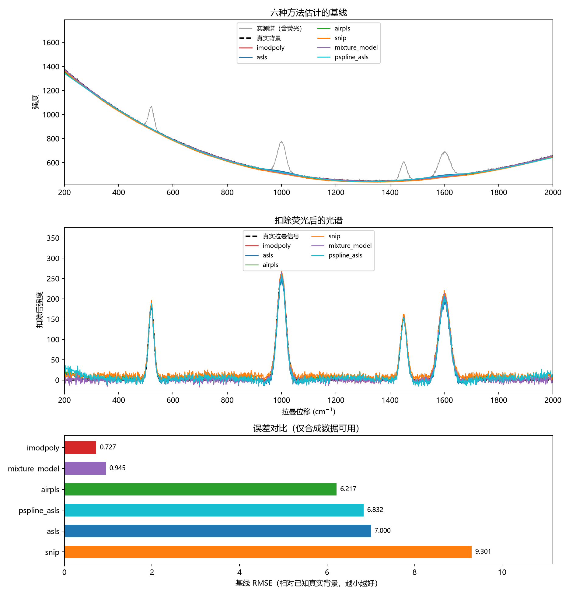
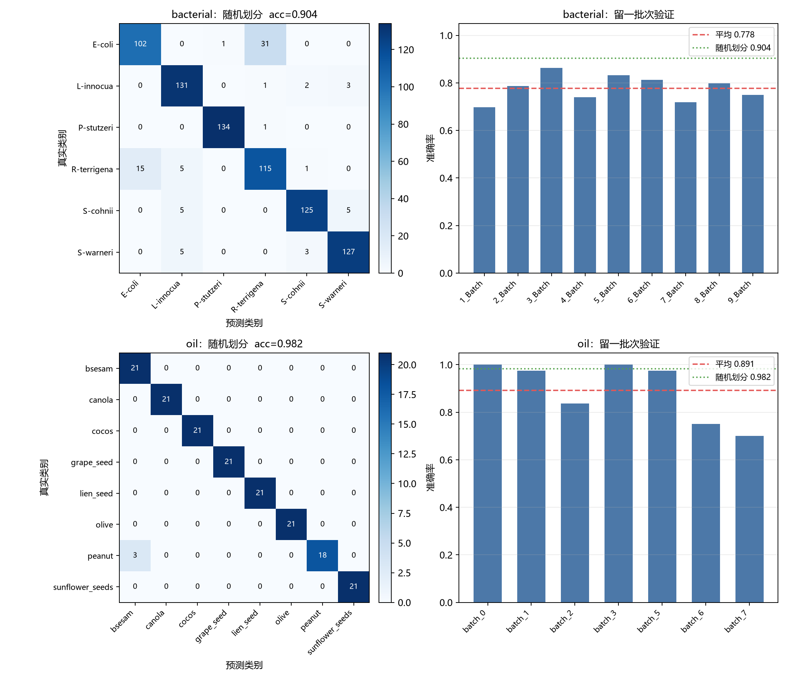

# Raman_forRecognition

拉曼光谱荧光背景扣除（基线校正）的复现与横向对比，基于 [pybaselines](https://github.com/derb12/pybaselines)。

拉曼光谱测量中，样品本身的荧光会产生一条缓慢变化的背景，把窄的拉曼峰抬高、甚至淹没。这个项目用 pybaselines 提供的多种算法把这条背景估计出来并减掉，同时在同一份数据上横向比较六种方法的差异。



## 这个项目做了什么

| 脚本 | 作用 |
|---|---|
| `01_quickstart.py` | 用合成光谱（4 个高斯峰 + 指数/二次背景 + 噪声）复现 ModPoly 与 IModPoly，并计算基线误差 |
| `02_process_my_csv.py` | 读取自己准备的两列 CSV，用 IModPoly 做校正，输出结果谱与图 |
| `compare_baseline_methods.py` | 在同一个光谱上同时运行 **6 种方法**，对比基线形状、校正谱与误差 |

## 快速开始

```bash
# 1. 准备环境
python -m venv .venv
.venv\Scripts\activate          # Windows
pip install -r requirements.txt

# 2. 运行模拟数据复现
python 01_quickstart.py

# 3. 处理自己的数据（需先放 my_raman.csv 在同目录）
python 02_process_my_csv.py

# 4. 六种方法横向对比
python compare_baseline_methods.py
python compare_baseline_methods.py --csv my_raman.csv
```

## 输入数据格式

两列 CSV，第一列拉曼位移（cm⁻¹），第二列强度，**第一行为表头**：

```csv
raman_shift_cm-1,intensity
200,1250
201,1252
202,1260
```

## 数据集

项目使用 **Zenodo 15279321** 的公开拉曼数据集（CC-BY-4.0），包含两个子集：

| 子集 | 内容 | 样本数 | 类别 | 点数 | 特点 |
|---|---|---|---|---|---|
| `Bacterial_data` | 单个细菌细胞 | 2710 | 6 种菌 | 1376 | 含 **9 个测量批次**，适合做跨批次泛化 |
| `Oil_data` | 食用油脂 | 560 | 8 种油 | 916 | 官方已划分 train 320 / test 240 |

下载方式（脚本已封装好，直接跑）：

```bash
mkdir -p data/raw && cd data/raw
curl -L -O https://zenodo.org/api/records/15279321/files/Bacterial_data.zip
curl -L -O https://zenodo.org/api/records/15279321/files/Oil_data.zip
cd ../.. && python -c "import zipfile; [zipfile.ZipFile(f'data/raw/{n}').extractall('data') for n in ('Bacterial_data.zip','Oil_data.zip')]"
```

解压后目录为 `data/Bacterial_data/` 与 `data/Oil_data/`，验证：

```bash
python 03_load_dataset.py
```

> **注意**：这两个数据集的 CSV 是"矩阵式"（第一行是位移轴，之后每行一条光谱），不是常见的两列格式，必须用 `raman_rec.load_bacterial()` / `load_oil()` 读取，不能用 `load_csv()`。

**引用（CC-BY-4.0 要求署名）**：

> Guo, S. *Raman spectral datasets from single bacterial cells and different oil*. Zenodo (2025). doi:10.5281/zenodo.15279321

## 识别实验结果

流水线：SNV 归一化 → StandardScaler → PCA(20) → 线性 SVM。两种评估协议对比：

| 数据集 | 随机划分 | 留一批次验证 | 差距 |
|---|---|---|---|
| bacterial（6 类菌，2710 条） | **0.904** | **0.778 ± 0.052** | **+0.126** |
| oil（8 类油，560 条） | **0.982** | **0.891 ± 0.118** | **+0.091** |



**这是本项目目前最值得关注的一组数字。** 随机划分看起来接近完美，但换成"留出一整个测量批次做测试"，
准确率就掉了 9–13 个百分点。说明模型学到的特征里有相当一部分是"这一批测量长什么样"（批次偏移），
而不是"这是什么物质"。

混淆矩阵还显示，细菌集的错误高度集中在 **E-coli ↔ R-terrigena** 这一对近缘种上（互相误判 31 条与 15 条），
其余四类的识别率都在 95% 以上。近缘种分离、跨批次泛化，是两个真实的开放问题。

复现：

```bash
python 04_classify.py --no-show                    # 两个数据集都跑
python 04_classify.py --dataset oil --classifier lda
```

## 批次校正实验（负结果）

> 详细技术报告（含逐方法失效机制、局限说明、可引用结论）：
> **[docs/batch-correction-negative-result.md](docs/batch-correction-negative-result.md)**

针对上面的 9–13 点差距，测试了三种**无需标签**的批次校正手段，结果**全部无效**：

| 预处理 | bacterial 留批次 | 相对 SNV | oil 留批次 | 相对 SNV |
|---|---|---|---|---|
| raw（不处理） | 0.759 | −1.9 pt | 0.763 | −12.9 pt |
| **SNV（基线）** | **0.778** | — | **0.891** | — |
| SNV + 一阶导数 | 0.642 | **−13.6 pt** | 0.861 | −3.0 pt |
| SNV + 批次中心化 | 0.784 | +0.6 pt | 0.857 | −3.4 pt |
| SNV + CORAL 对齐 | 0.698 | **−8.1 pt** | 0.863 | −2.9 pt |
| SNV + 指纹区(500–1800) | 0.748 | −3.0 pt | 0.882 | −0.9 pt |


**唯一正增益（+0.6 pt）小于一个标准差（±7.9 pt），不构成有效提升。**

原因分析：SNV 逐条减均值除以标准差，恰好抵消了跨批次最易变化的加性偏移与乘性缩放；
剩下的差异是峰位微移、峰宽变化等非线性成分，线性变换处理不了。导数放大噪声、
批次中心化连带减掉类别共性、CORAL 的单源域假设在多批次训练集上不成立。

详细分析见 `docs/batch-correction-negative-result.md`（技术报告）与
`experiments/2026-11-19-p3-batch-correction.md`（实验记录）。**这个负结果本身有价值**：
它说明浅层预处理已到瓶颈，提升必须来自数据驱动的不变性（增强 / 域对抗）或度量学习。

```bash
python 05_batch_effect.py --no-show
```

## 六种方法的对比结果

合成光谱（1600 点，噪声标准差 5.0，真实背景已知）：

| 方法 | 最优参数 | 基线 RMSE |
|---|---|---|
| `imodpoly` | poly_order=5 | **0.727** |
| `mixture_model` | p=0.7 | 0.945 |
| `airpls` | lam=1e6 | 6.217 |
| `pspline_asls` | lam=1000, p=0.05 | 6.832 |
| `asls` | lam=1e6, p=0.05 | 7.000 |
| `snip` | max_half_window=40 | 9.301 |

> 共选取 6 个有代表性的方法。pybaselines 一维方法实际有 60 余个。

## 三个必须注意的结论

1. **RMSE 排名不等于方法优劣。** 这条合成谱的真实背景接近低阶多项式，所以 `imodpoly` 占优有数据配合的成分。真实样品的荧光形状往往不是多项式，`asls`、`airpls` 可能更稳。

2. **参数影响大于方法选择。** 同一个 `imodpoly`，`poly_order=2` 时 RMSE 约 13.8，`poly_order=5` 时是 0.727。换算法之前先调参。

3. **真实数据没有真值，不能用 RMSE 自动选参。** 合成数据的"自动挑最优参数"是它独有的特权。真实数据只能靠峰形是否被削、负值比例、重复谱一致性来判断。

## 目录结构

```
Raman_forRecognition/
├── raman_rec/                    # 核心代码包（P0 重构后新增）
│   ├── spectrum.py               #   Spectrum 数据结构：归一化/平滑/寻峰/信噪比
│   ├── preprocess.py             #   七种基线方法的统一入口 + 参数网格
│   ├── io.py                     #   两列 CSV 读写（自动处理 GBK/UTF-8 与表头）
│   ├── synthetic.py              #   带真值的合成光谱生成器
│   ├── datasets.py               #   真实数据集加载器（细菌 / 油脂）与划分策略
│   ├── classify.py               #   特征构造、PCA+分类器流水线、两种评估协议
│   └── transfer.py               #   批次校正：导数 / 批次中心化 / CORAL 域对齐
├── 01_quickstart.py              # 演示：模拟数据 ModPoly vs IModPoly
├── 02_process_my_csv.py          # 实用：处理自备 CSV
├── 03_load_dataset.py            # 数据：加载真实数据集、打印概览、画各类平均谱
├── 04_classify.py                # 识别：PCA+SVM 分类，对比随机划分与留一批次
├── 05_batch_effect.py            # 校正：八种预处理 × 两种协议的批次效应实验
├── compare_baseline_methods.py   # 对比：六种方法横向比较（支持 --csv）
├── experiments/README.md         # 实验记录规范与表格
├── docs/                         # 技术报告
│   └── batch-correction-negative-result.md   # 批次校正负结果详细分析
├── my_raman.csv                  # 示例输入数据
├── quickstart_result.png         # 01 的输出图
├── my_raman_corrected.png        # 02 的输出图
├── compare_result.png            # 对比脚本的三联图
├── dataset_overview.png          # 03 的各类平均光谱图
├── classification_result.png     # 04 的混淆矩阵与各折准确率
├── batch_effect_result.png       # 05 的各预处理两种协议对比
├── data/                         # 数据集目录（不入库，见上文「数据集」）
├── 操作说明.txt                   # 中文操作手册
├── requirements.txt
└── .gitignore
```

其余 `*_corrected.csv`、`demo_raman.csv` 等中间产物可由脚本重新生成，已在 `.gitignore` 中排除。

## 核心 API

所有处理都以 `Spectrum` 为中心，每一步返回新对象，可以链式调用：

```python
from raman_rec import load_csv, remove_baseline

spec = load_csv("my_raman.csv")                 # 读数据，自动跳过表头、处理 GBK
spec = remove_baseline(spec, "imodpoly", poly_order=5)
spec = spec.smoothed(window=7).normalized("snv")  # 平滑 + 标准化

peaks = spec.peaks(prominence_frac=0.05)        # 寻峰
print(peaks["shift"][:5])                       # 前五个峰位
print("SNR:", spec.snr())
print("负值比例:", spec.negative_ratio())
```

可用基线方法：`modpoly` / `imodpoly` / `asls` / `airpls` / `snip` / `mixture_model` / `pspline_asls`。

## 开发路线

| 阶段 | 内容 | 状态 |
|---|---|---|
| P0 | 代码重构为包结构，统一数据与预处理入口 | ✅ 已完成 |
| P1 | 接入真实光谱数据集（Zenodo 15279321），统一格式与划分 | ✅ 已完成 |
| P2 | PCA + SVM 分类基线，跑通第一个识别准确率 | ✅ 已完成 |
| P3 | 批次效应校正实验（导数 / 批次中心化 / CORAL / 波段筛选） | ✅ 已完成（负结果） |
| P4 | 数据驱动的批次不变性：训练增强或域对抗 | ⬜ 待开始 |
| P4 | 开放集拒识 / 混合物解混 | ⬜ |
| P5 | 工程化：CLI、单元测试、文档 | ⬜ |

## 环境

- Python 3.13
- numpy 2.5 / scipy 1.18 / matplotlib 3.11
- pybaselines 1.2.x

## 常见问题

**`ImportError: DLL load failed ... 应用程序控制策略已阻止此文件`**

Windows 的应用控制策略（Smart App Control / WDAC）会拦截新下载的未签名编译扩展（`.pyd` / `.dll`），
典型表现是 `import sklearn` 或 `import pandas` 时报这个错。解除方法（PowerShell）：

```powershell
Get-ChildItem -Path ".venv\Lib\site-packages" -Recurse -File |
  Where-Object { $_.Extension -in ".dll",".pyd" } | Unblock-File
```

个别情况下需要对新安装的包里所有文件执行一次 `Unblock-File` 才能全部加载。

**`PermissionError: [Errno 13] ... .csv`**

文件正被 WPS / Excel 打开，Windows 下它们会对文件加独占锁。关掉软件再跑脚本即可。

## 参考与致谢

- [pybaselines](https://github.com/derb12/pybaselines) —— 基线校正算法库，BSD-3-Clause
- ModPoly / IModPoly 原始方法出自 Lieber & Mahadevan-Jansen (2003)

## 许可

本项目代码采用 MIT License，见 [LICENSE](LICENSE)。
