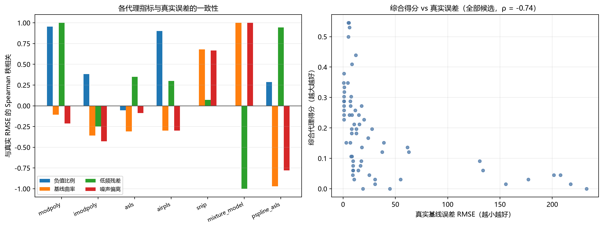

# 2026-11-19 · P10 无真值条件下的基线参数选择

## 目的

这是项目申报书的核心创新点：**真实光谱没有"正确背景"这个标准答案，如何挑选基线校正参数？**

现状是沿用默认参数或凭经验手动调。而实测显示参数影响远大于方法差异——
同一个 IModPoly，阶数取 2 时基线误差约 13.8，取 5 时 0.727，相差近 20 倍。

本轮要回答两个问题：
1. 不用真值，能否把参数排对？（方法可行性）
2. 排对了参数，下游识别是否受益？（实际价值）

## 方法：四个无真值代理指标

每个指标惩罚一种具体的失败模式，全部"越小越好"：

| 指标 | 定义 | 惩罚的失败模式 |
|---|---|---|
| 负值比例 | 校正谱低于 −2σ 的样本占比 | 扣过头，把峰削成负值 |
| 基线曲率 | 基线二阶差分均方根 / 原谱幅度 | 基线跟着峰起伏 |
| 低频残差 | 校正谱大窗口移动平均的能量占比 | 欠扣（残留背景）或过扣（负凹陷） |
| 噪声偏离 | 校正前后噪声水平之比与 1 的偏差 | 基线吃掉了噪声（过拟合） |

合成规则：**最差项决定得分**，`score = 1 − max(各指标秩归一化)`。

## 三次迭代：指标设计踩的坑

### 第一版：用"信噪比"作为第四项 —— 失败

信噪比定义为 `max(校正谱)/噪声`。问题：**残留背景会把最大值抬高，于是信噪比奖励"欠扣"**。

后果很直接：`pspline_asls` 选出灾难参数，真实 RMSE 232（最优 6.8）；`asls` 选出排名 20/20 的参数。

### 第二版：换成"噪声偏离"，但用等权平均 —— 仍然失败

噪声偏离修正了上面的问题，但等权平均暴露了新缺陷：

**"根本不扣背景"的解（基线取常数或零）在前三项上全部满分**——曲率为零、无负值、噪声不变。
四项等权后总分很高，`asls` 又选出 RMSE 177 的参数。

### 第三版：改为"最差项决定得分" —— 通过

取 `max` 而非 `mean`：只要有一项（这里是低频残差）暴露"背景没扣掉"，总分就上不去。
灾难解被自动排除。

**这个迭代过程本身值得记录**：代理指标不是"看起来合理"就行，
每一个都必须对照"它会不会被退化解骗过"来设计。

## 验证一：合成数据上的排序一致性

在已知真值的合成谱（1600 点，噪声 σ=5.0）上，对七个方法的全部 67 个候选参数，
同时计算真实 RMSE 与综合代理得分，求 Spearman 秩相关：

| 方法 | 候选数 | 综合得分 ρ | 默认参数 RMSE | 代理选参 RMSE | 真实最优 RMSE | 选中排名 |
|---|---|---|---|---|---|---|
| modpoly | 7 | −0.67 | 27.69 | 5.19 | 4.53 | 3/7 |
| imodpoly | 7 | −0.43 | 19.03 | **0.81** | 0.73 | 2/7 |
| asls | 20 | −0.61 | 10.60 | 8.41 | 7.00 | 4/20 |
| airpls | 5 | −0.87 | 18.01 | 8.32 | 6.22 | 2/5 |
| snip | 7 | −0.68 | 44.79 | **9.30** | 9.30 | **1/7** |
| mixture_model | 6 | 0.00 | 0.945 | 0.947 | 0.945 | 4/6 |
| pspline_asls | 15 | −0.11 | 14.98 | 15.46 | 6.83 | 6/15 |
| **全部合并** | **67** | **−0.74** | — | — | — | — |

**关键数字：全部候选合并后 ρ = −0.74**（负号表示得分越高、误差越小，符合预期）。

代理选参把基线误差从默认值大幅拉低：imodpoly 19.03 → 0.81（最优 0.73），
snip 44.79 → 9.30（恰为最优），modpoly 27.69 → 5.19。

`mixture_model` 的 ρ 为 0，原因是它的默认参数已接近最优、网格内区分度极小，
负值比例在全部候选上恒为 0（无区分度）。`pspline_asls` 表现一般（6/15），
说明该方法的参数敏感性形态与本套指标不完全匹配。



## 验证二：真实数据上的下游效果

真实数据无真值，只能用下游识别准确率作为外部判据。

做法：先抽 60 条作校准集，按代理指标逐条投票选出一套全局参数；
两套校正结果分别送进同一分类流水线（SNV → 全维 → 线性 SVM），比较留一批次准确率。

| 方案 | 参数 | 留批次准确率 | 标准差 |
|---|---|---|---|
| 默认参数 | poly_order = 2 | 0.841 | 0.064 |
| 代理选参 | poly_order = 4 | 0.840 | 0.068 |
| 变化 | — | **−0.002** | — |

**下游没有可见差异。** 差 0.002，远小于标准差 0.064。

## 结论

**1. 方法是可行的。** 在合成数据上，无真值代理指标与真实误差的秩相关达 −0.74，
选出的参数把基线误差从默认值拉低一个数量级，多数方法接近真实最优。

**2. 但下游收益可以忽略。** 真实数据上两套参数的识别准确率几乎相同。
这与 P3 的结论一致：**逐条标准正态变换（SNV）已经吸收了基线差异的主要成分**，
前处理参数的精细程度对最终识别不再敏感。

**3. 因此要修正一个说法。** 申报材料里曾写"参数影响大于方法选择"——这在**基线误差**层面上成立
（近 20 倍差异），但在**识别准确率**层面上不成立。更准确的表述是：

> 参数选择显著影响基线校正的质量（误差相差近 20 倍），
> 但在本任务中该差异被后续标准化与分类环节吸收，对最终识别影响有限。
> 这也解释了为何前处理环节的改进难以提升识别性能。

## 局限

- 校准集只取 60 条，投票一致性仅 50%，阈值与样本量的关系未做敏感性分析。
- 只验证了 imodpoly 一个方法的下游影响；asls 等参数更多维的方法未做。
- 代理指标对 `pspline_asls` 效果一般（排名 6/15），说明它不是万能的。
- 未与"人工经验调参"对照——这需要领域专家的判断作为基准，本轮不具备条件。

## 命令

```bash
.venv/Scripts/python.exe 12_param_selection.py                    # 合成数据验证
.venv/Scripts/python.exe 12_param_selection.py --stage apply      # 真实数据下游验证
```
