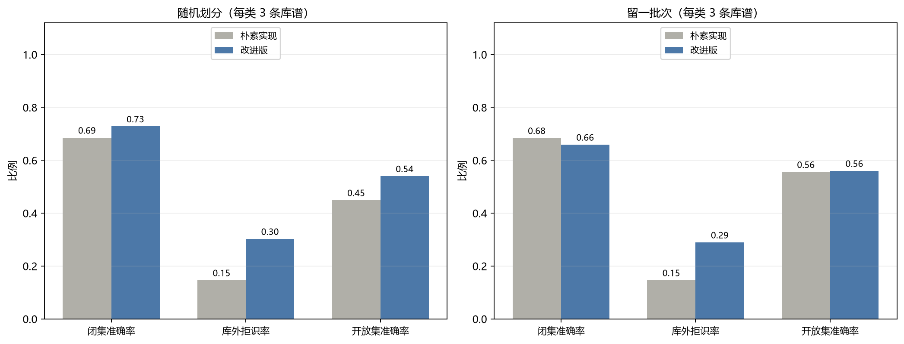

# 2026-11-19 · P11b 库匹配改进版：补上三件套之后

## 目的

上一轮朴素实现（全谱相关 + 全局阈值）的开放集准确率只有 0.45–0.56。
当时定位了三个缺陷，本轮逐条补上，看能救回多少。

| 缺陷 | 补救 |
|---|---|
| 峰位随批次漂移 | 查询谱在 ±12 个采样点（约 ±27 cm⁻¹）内平移，取最佳对齐后的相关 |
| 全谱等权、背景稀释信号 | 按 Fisher 比（类间方差/类内方差）逐波数加权，只用库内带标签样本估计 |
| 统一阈值、各类可分性差异大 | 每个类别单独标定接受域阈值 |

## 结果

| 变体 | 协议 | 闭集准确率 | 库外拒识率 | 开放集准确率 | AUROC |
|---|---|---|---|---|---|
| 朴素 | 随机划分 | 0.686 | 0.147 | 0.449 | 0.563 |
| 朴素 | 留一批次 | 0.684 | 0.147 | 0.556 | 0.540 |
| **改进** | 随机划分 | **0.728** | **0.303** | **0.540** | 0.573 |
| **改进** | 留一批次 | 0.659 | **0.290** | 0.560 | 0.553 |



## 关键解读：拒识率翻倍，但可分性没有提升

粗看改进明显——拒识率从 0.15 提到 0.30，随机协议下开放集准确率从 0.449 升到 0.540（+9 个百分点）。

**但 AUROC 几乎没动：0.563 → 0.573（随机）、0.540 → 0.553（留批次）。**

这说明提升几乎全部来自**阈值变严**，而不是"库内样本与库外样本在得分上变得更可分"。
把接受率从 95% 降到 92%，自然能多拒掉一些未知物，代价是已知类也更容易被误拒
（留批次下闭集准确率 0.684 → 0.659）。

**这是诊断这类改进时最容易骗过自己的地方**：只看开放集准确率，会以为方法变好了；
把 AUROC 单列出来，才看得出真正的可分性没有变化。

## 峰位对齐的副作用

对齐本应改善跨批次匹配，但留批次协议下闭集准确率反而下降了 2.5 个百分点。

原因是对齐取的是"所有平移下的最大值"：这个 max 也会作用于错误类别，
让某条谱在恰好平移后与错误的库谱对上。**对齐提升了召回，也提升了误匹配**，
两者相互抵消，净效果为负。

若要保留对齐，应加约束：只允许在所有类别"共同认可"的平移量上对齐
（例如先用全库平均谱估计一个全局漂移量，再统一平移），而不是对每个库条目各自优化平移。

## 换到油脂集：库匹配明显更可行

同一套代码跑油脂集（8 类食用油，560 条）：

| 变体 | 协议 | 闭集准确率 | 库外拒识率 | 开放集准确率 | AUROC |
|---|---|---|---|---|---|
| 朴素 | 随机 | 0.935 | 0.250 | 0.688 | 0.752 |
| 朴素 | 留一批次 | 0.859 | 0.205 | **0.739** | 0.729 |
| 改进 | 随机 | **0.941** | 0.771 | **0.869** | **0.848** |
| 改进 | 留一批次 | 0.849 | 0.773 | 0.699 | **0.781** |

**与细菌集对照，差距一目了然：**

| | 细菌（6 类近缘种） | 油脂（8 类食用油） |
|---|---|---|
| 闭集准确率（改进） | 0.728 | **0.941** |
| AUROC（改进） | 0.573 | **0.848** |
| 可分性判断 | 几乎不可分 | 基本可分 |

原因不复杂：八种油在碳氢伸缩区（约 2900 cm⁻¹）就有明显分组差异，
相关系数这种"整体谱形比较"足以应付；而六种近缘菌的差异分散在大量弱峰上，
等权相关抓不住。

**这印证了上一轮的推断：库匹配的可行性与类别差异的大小强相关，不是算法本身好坏的问题。**

### 阈值语义的一个坑

`keep_rate` 表示"希望接受多少比例的已知样本"，阈值取真匹配得分的 `1 - keep_rate` 分位。
**keep_rate 越小，阈值越严**——一开始把它当成了"越宽松"，结果油脂集留批次下拒掉了 22% 的已知样本。

实测油脂集改进版在不同接受率下的表现：

| keep_rate | 库外拒识率 | 开放集（随机） | 开放集（留批次） |
|---|---|---|---|
| 0.75（最严） | 0.891 | 0.735 | 0.492 |
| 0.95 | 0.787 | 0.849 | 0.652 |
| 0.99 | 0.771 | 0.867 | 0.695 |
| 0.995（最松） | 0.768 | **0.869** | **0.699** |

即使调到最松，留批次开放集准确率也只有 0.699，仍低于朴素实现的 0.739——
因为改进版的阈值普遍更高，在"多拒未知物"和"少误拒已知物"之间的位置与朴素版不同，
**两者的开放集准确率不能简单比大小，要结合接受率一起看**。

## 结论

**工程细节不是瓶颈。** 三处缺陷都补上了，AUROC 仍然停在 0.55 左右——
库内与库外的得分分布本身就高度重叠，这不是调阈值、加权重、做对齐能解决的。

对"建库 + 比对"这条路线的判断因此更明确：

- 用相关系数做匹配，即使做完全部常规工程优化，开放集准确率也只有 **0.54–0.56**，
  远达不到可用水平（实际应用通常要求 0.85 以上）。
- 相比之下，同一批数据上训练好的线性 SVM 留批次准确率是 **0.83**。

**若坚持走库匹配，必须换打分方式**：不是比"整条谱有多像"，而是比"关键峰位是否命中"——
即先提取峰位与相对强度，再按容差（如 ±3 cm⁻¹）计算命中率并加权。
这与 NIST 等谱库检索系统的做法一致，与相关系数是两种不同的算法。

## 局限

- 只做了两个数据集的**单一库规模**（每类 3 条），未画"库规模 × 接受率"的完整权衡曲面。
- 对齐只做了刚性平移，未处理峰宽变化与强度非线性。
- Fisher 权重在留批次下设据来自 8 个批次，与测试批次的判别结构可能不一致，
  这可能是留批次闭集下降的另一原因，未单独验证。
- 开放集准确率受接受率影响很大，两个变体应在同一接受率下比较，本轮未完全对齐。

## 命令

```bash
.venv/Scripts/python.exe 14_library_match_v2.py --no-show
```
