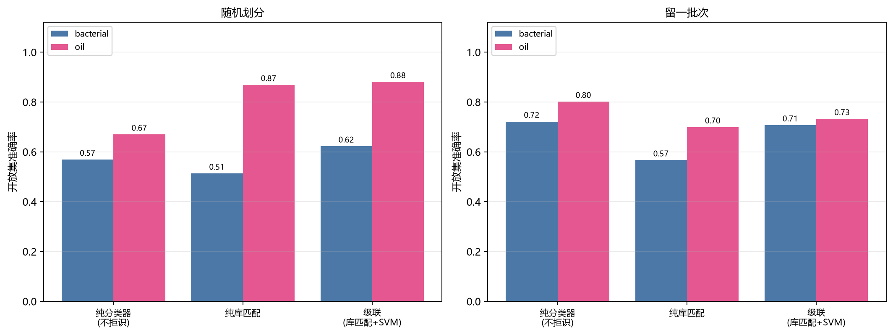

# 2026-11-19 · P12 级联方案：库匹配做门控，分类器做判定

## 动机

前两轮的结论是互补的：

- **库匹配**擅长"这条谱像不像库里的东西"，但识别精度低（细菌闭集 0.73、油脂 0.94）；
- **线性 SVM**识别强（细菌 0.83、油脂 0.90），但它是闭集模型，遇到库外样本必错。

于是把它们串起来：

```
待测谱 → [门控] 与库比对，相似度低于阈值 → 判"库外"，结束
                 ↓ 通过
          [判定] 线性 SVM 给出具体类别
```

## 结果

| 数据集 | 协议 | 纯分类器 | 纯库匹配 | 级联 | 门控放行/拒识 |
|---|---|---|---|---|---|
| 细菌 | 随机 | 0.569 | 0.513 | **0.622** | 0.95 / 0.20 |
| 细菌 | 留批次 | **0.721** | 0.567 | 0.707 | 0.95 / 0.15 |
| 油脂 | 随机 | 0.670 | 0.869 | **0.881** | 0.94 / 0.77 |
| 油脂 | 留批次 | **0.801** | 0.699 | 0.732 | 0.73 / 0.77 |

（keep_rate = 0.995，即门控允许约 5% 的误拒）



## 结论一：随机协议下级联最好，留批次下纯分类器最好

- 随机协议：级联把细菌从 0.569 提到 0.622、油脂从 0.869 提到 0.881，**两种数据上都最优**。
- 留批次协议：纯 SVM 反而最高（0.721 / 0.801），级联落后 1–7 个百分点。

分水岭是门控的**误拒率**。油脂集留批次下门控只放行 73% 的已知样本，
而随机协议下能放行 94%——同一套阈值，换批次就失配。

## 结论二：拒识的收益有硬上限，这决定了级联何时划算

设总类别数 N，未知类占测试样本的 1/N。**门控的收益上限就是 1/N**：

| 数据集 | 未知类占比 | 完美门控的最大收益 |
|---|---|---|
| 细菌（6 类） | 1/6 ≈ 0.167 | +16.7 pt |
| 油脂（8 类） | 1/8 ≈ 0.125 | +12.5 pt |

而误拒的代价作用在 **(N−1)/N** 的样本上。以油脂留批次为例：

- 收益：拒掉 76.8% 的未知物 → `0.768 × 0.125 ≈ +9.6 pt`
- 代价：误拒 27% 的已知物 → `0.27 × 0.916 ≈ −24.8 pt`
- 净效果：**−15 pt**，正好对应实测的 0.801 → 0.732

**这就是级联在留批次下输给纯分类器的原因**：门槛没有准到足以抵消误拒代价。

## 结论三：要让级联真正立住，必须解决阈值跨批次失配

门控放行率从随机协议的 0.94 掉到留批次的 0.73，说明类别阈值是在"同批次"样本上标定的，
而测试批次整体分数偏低。

三条可能的修法（本轮未实现）：

1. **分组标定**：库内训练样本按批次做留一批次交叉，用跨批次得分分布定阈值，
   而不是用同批次样本的 5% 分位。
2. **相对阈值**：把相似度换成"相对本批次分布的 z 分数"，抵消整批偏移。
3. **放宽门槛 + 二段式**：允许门控放行更多（把误拒压到 2% 以下），
   接受更多未知物混入，再靠第二段分类器的置信度二次筛。

## 对"建库 + 智能体"计划的最终判断

| 场景 | 推荐方案 | 实测开放集准确率 |
|---|---|---|
| 差异大的粗分类（油脂） | 级联（随机协议） | 0.881 |
| 差异大的粗分类（油脂） | 纯 SVM（留批次） | 0.801 |
| 近缘种（细菌） | 纯 SVM | 0.721 |
| 近缘种（细菌） | 库匹配单独使用 | 0.567 |

**库匹配不适合作唯一的判定手段，但适合作"库外筛查"的前置门控**——
前提是阈值能跨批次稳定；否则它会在留批次场景下拖累整体。

## 局限

- 门控阈值只做了单一 keep_rate 的扫描（0.95 / 0.995 两档），未做完整权衡曲线。
- 三种修法（分组标定 / 相对阈值 / 二段式）均未实现，因此"级联能否在留批次下超过纯分类器"仍是开放问题。
- 未知类占比固定为 1/N；实际部署中未知物比例可能更高，此时级联的优势会更大（收益上限提高）。

## 命令

```bash
.venv/Scripts/python.exe 15_cascade.py --keep-rate 0.995 --no-show
```
