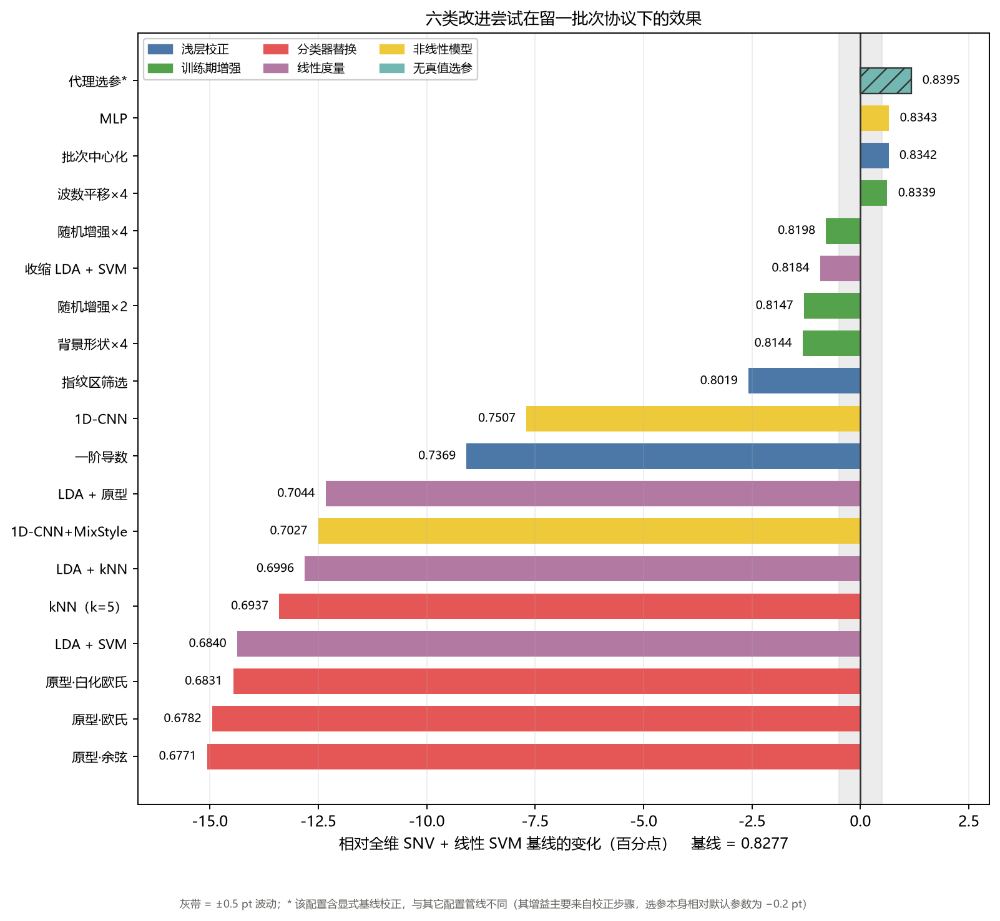

# 2026-11-19 · P15 论文图 2：六类改进尝试的汇总

## 目的

论文需要一张"把所有尝试放在一起看"的图。这张图要回答：

> 这些改进手段，在严格协议下到底有没有用？

## 做图前先解决可比性

历史上的实验并不都在同一设置下完成：

| 轮次 | 当年设置 | 能否直接比较 |
|---|---|---|
| P3 浅层校正 | PCA=20 | 否，需取全维复核值 |
| P4 增强 | 全维 | 可 |
| P5 分类器替换 | PCA=20 | **否，本脚本重算** |
| P6 度量学习 | 全维 | 可 |
| P8 非线性 | 全维 | 可 |
| P10 选参 | 全维 + 显式基线校正 | 管线不同，需标注 |

处理方式：

1. 基线统一为**全维 SNV + 线性 SVM**（留批次 0.8277）；
2. P3 取 `dimension_sweep.csv` 中 `recheck_no_pca` 的复核值；
3. P5 用同一协议在全维上重算（当年只做了 PCA=20）；
4. P10 保留但加斜纹与星号，注明"含显式基线校正，管线不同"；
5. 每个数值在 CSV 里都带来源标签，可逐条核对。

## 结果

19 个配置，相对基线的变化：

| 区间 | 数量 | 具体配置 |
|---|---|---|
| 高于基线 0.5 pt 以上 | **4** | 波数平移×4 +0.62、批次中心化 +0.65、MLP +0.66、代理选参 +1.18\* |
| 落在 ±0.5 pt 内 | **0** | 最接近的是收缩 LDA（−0.93），仍在带外 |
| 低于基线 0.5 pt 以上 | **15** | 最差为原型·余弦（−15.06）与一阶导数（−9.08） |

\* 代理选参那条含显式基线校正，增益主要来自校正步骤本身；在同一实验内部，
选参相对默认参数为 **−0.2 pt**。



## 三个判读

**1. 绝大多数尝试是负效果，而且不是"差一点"。**
原型类方法在留批次下只有 0.68（−15.0 pt），远低于随机划分时代的印象（0.72–0.82）。
这说明"换分类器"这条路的失败幅度被随机划分严重掩盖了。

**2. 四条跑赢基线的配置，幅度都在 1 pt 以内，且没有任何一条落在 ±0.5 pt 的噪声带内。**
这本身是个有意思的分布特征：**要么明显变差，要么微弱变好，没有"差不多"的中间状态**。
0.62–0.66 pt 的三条与种子的划分波动（0.9 pt）同量级，更可能反映"同一批数据上选配置的偶然性"。

**3. 唯一超过 1 pt 的那条来自管线差异，不是选参本身。**
这是做这张图最有价值的发现：**如果不把管线差异标出来，很容易误读成"选参提升了 0.9 个点"**。

## 局限：±0.5 pt 的灰带只是启发式

灰带取 ±0.5 pt，是给人看的参考带，不是统计判据。严格的判据应当是**配对的折间检验**：

- 所有配置都在同样的 9 折上评估，因此可以做配对比较（Wilcoxon 符号秩检验）；
- 配对检验的自由度来自折间差异，比"折间标准差 ÷ √9"更有效力；
- 本图未做该检验，列为投稿前必补项（见 `docs/paper-outline.md` 第六节）。

## 命令

```bash
.venv/Scripts/python.exe 18_improvement_summary.py --no-show
```
