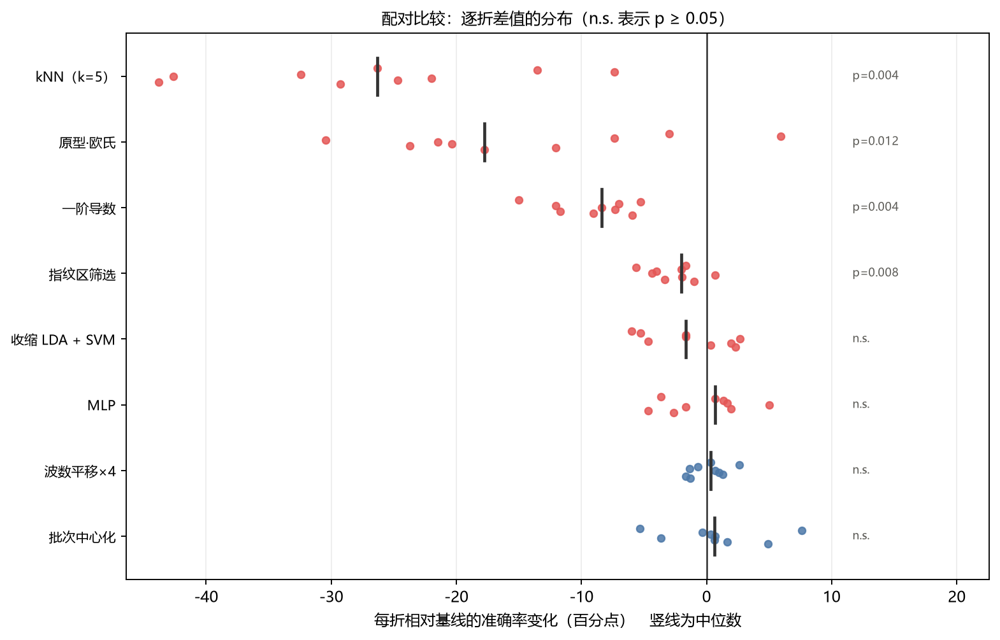

# 2026-11-19 · P16 配对检验：那 0.6 个百分点算不算提升

## 问题

论文图 2 里，三个配置比基线高 0.6–0.7 个百分点。它们落在"噪声带"边缘，
但噪声带只是视觉参考，不是判据。要回答"算不算提升"，必须做**配对检验**：

所有配置都在同样的 9 折上评估，因此可以对"每折的差值"做符号秩检验。
配对检验消掉了"这一折本身难不难"这个共同变量，效力远高于比较两个独立均值。

## 三个必须先对齐的实现细节

做这轮之前，重算结果与历史数字对不上，逐项排查后发现三处：

1. **折划分**：不能自造（`groups != g`），必须用 `group_split`，否则无批次标签的样本被错误排除，
   基线从 0.8277 变成 0.8465。
2. **管线**：项目管线是 `StandardScaler → (PCA) → SVC`。漏掉 StandardScaler 会让基线变成 0.8465
   ——逐波数方差归一化本身就有判别作用，不能省。
3. **LDA 的 lsqr 求解器不支持 `transform`**，要用 `decision_function` 的输出作为降维特征。

对齐之后基线精确回到 0.8277，与历史结果一致。

## 结果

| 配置 | 留批次 | Δ均值 | Δ中位 | 胜出折数 | p 值 | 显著 |
|---|---|---|---|---|---|---|
| 批次中心化 | 0.8350 | **+0.72** | +0.65 | 6/9 | 0.441 | 否 |
| 波数平移×4 | 0.8288 | +0.11 | +0.33 | 5/9 | 1.000 | 否 |
| MLP | 0.8255 | −0.22 | +0.66 | 5/9 | 0.910 | 否 |
| 收缩 LDA + SVM | 0.8144 | −1.34 | −1.67 | 4/9 | 0.496 | 否 |
| 指纹区筛选 | 0.8019 | −2.59 | −2.01 | 1/9 | **0.008** | 是 |
| 一阶导数 | 0.7369 | −9.08 | −8.39 | 0/9 | **0.004** | 是 |
| 原型·欧氏 | 0.6831 | −14.46 | −17.76 | 1/9 | **0.012** | 是 |
| kNN（k=5） | 0.5588 | −26.89 | −26.33 | 0/9 | **0.004** | 是 |



## 三个结论

**1. 三条"跑赢基线"的配置全部不显著**（p = 0.44 / 1.00 / 0.91）。
批次中心化胜了 6 折，看似有方向性，但 p 值说明这个优势与折间波动无法区分。
**图 2 里那三根 0.6 pt 的柱子，不能写成"提升"。**

**2. 所有明显变差的配置都显著**（p 全部 < 0.02），而且方向一致（0–1/9 折胜出）。
这说明"这些手段有害"是有统计支撑的，不是个别折拖累。

**3. MLP 是个典型陷阱：均值 −0.22，但中位数 +0.66。**
均值被一两折的崩坏拉低，中位数却显示"多数折更好"。只看均值会得出相反结论，
必须同时看分布——这正是配对散点图的价值。

## 附带发现：kNN 的失败比预想的严重

同一管线（含 StandardScaler）下：

| 设置 | kNN 留批次准确率 |
|---|---|
| PCA=20（历史结果） | 0.796 |
| 全维（本次） | **0.559** |

**掉了 24 个百分点**，是所有配置里最差的（−26.9 pt）。这是维度灾难最干净的证据：
kNN 依赖距离，1376 维下"最近邻"已失去意义；而 SVM 靠间隔最大化，几乎不受影响。

这也解释了为什么早年光谱分类文献几乎都先降维——**对 kNN 是必需的，对 SVM 则不是**。

## 局限

- 只有 9 折，Wilcoxon 双侧检验的最小可达 p 约 0.0039，效力有限；
  若要更强结论需增加批次（更多折）。
- 未做多重比较校正（8 个配置 × 1 次检验）。若严格按 Bonferroni，阈值应为 0.006，
  此时指纹区（0.008）会变成不显著，但导数/kNN/原型仍显著。
- 配对的前提是折划分完全相同，本脚本已保证；但历史 CSV 中的数值来自各自脚本，
  个别配置（如批次中心化 0.8342 vs 0.8350）存在微小差异，属实现细节，未逐一追平。

## 命令

```bash
.venv/Scripts/python.exe 19_paired_test.py --no-show
.venv/Scripts/python.exe 19_paired_test.py --skip-slow --no-show   # 跳过 MLP 与增强
```
