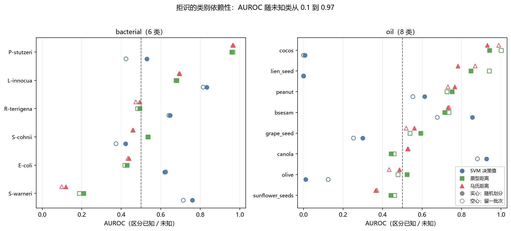

# 2026-11-19 · P17 论文图 3：拒识能力的类别依赖性

## 目的

论文图 3 要传达一句话：**"平均 AUROC"这个数字没有决策意义**——同一个模型、同一套评分器，
换一个未知类，AUROC 可以从 0.10 跳到 0.99。

P7 的报告里给过分类别数值，但没有落盘成结果文件。论文图必须可复现，
因此本轮按原协议重新计算（`20_openset_perclass.py`），并把每一项存进 CSV。

## 设计

- 留一类法：每次把 1 类排除在训练外当作未知物
- 两种协议：随机划分（实心点）、留一批次（空心点）
- 三种评分器：SVM 决策值（圆）、原型距离（方）、马氏距离（三角）
- 指标：AUROC（已知类测试样本 vs 未知类样本）

## 结果

### 细菌集（留一批次，马氏距离）

| 未知类 | AUROC | 位置 |
|---|---|---|
| P-stutzeri | **0.964** | 远离已知类，易检出 |
| L-innocua | 0.692 | 中等 |
| R-terrigena | 0.473 | **低于随机** |
| S-cohnii | 0.459 | 低于随机 |
| E-coli | 0.434 | 低于随机 |
| S-warneri | **0.098** | 远低于随机：比已知样本"更像已知" |

### 油脂集（留一批次，马氏距离）

| 未知类 | AUROC |
|---|---|
| cocos | **0.988** |
| lien_seed | 0.872 |
| bsesam | 0.741 |
| peanut | 0.728 |
| canola | 0.533 |
| grape_seed | 0.516 |
| olive | 0.430 |
| sunflower_seeds | **0.371** |



## 三个发现

**1. 两个数据集呈现同一模式：部分未知类几乎完美可检，部分低于随机。**
细菌 0.098–0.964，油脂 0.371–0.988。这不是某个数据集的偶然，
而是"未知物落在特征空间什么位置"的结构性问题。

**2. 低于随机的未知类（S-warneri 0.098、sunflower_seeds 0.371）才是最危险的。**
AUROC < 0.5 意味着它们的得分**系统性高于**已知类样本——模型认为它们比真已知样本
"更像已知"。这类未知物不会被任何基于距离/密度的方法检出，只会被自信地误判。

**3. 评分器之间的分歧本身携带信息。**
以细菌 E-coli 为例：SVM 决策值在留批次下 AUROC 约 0.72，而马氏距离只有 0.43。
"哪个评分器认为它是未知的"与"它像哪个类"相关——这提示评分器融合可能比单评分器更好，
是后续可尝试的方向（本轮未做）。

## 与闭集结论的呼应

油脂集闭集准确率 0.94（接近可用），但拒识 AUROC 仍有 0.37 的类；
细菌集闭集 0.83，拒识 0.10 的类。

**闭集好 ≠ 拒识好。** 原因在 P7 已分析：拒识的前提是"未知物离已知类远"，
而闭集准确率高只说明"已知类彼此分得开"。两者是不同的几何条件。

## 局限

- 每种设置只用 1 个未知类，未做"多类同时未知"的组合实验（那会更难）。
- 只测三种距离/边界型评分器，未测能量分数、OpenMax。
- 阈值固定在 95% 接受率；未画完整的"已知接受率–未知拒识率"权衡曲线
  （那是拒识系统设计时真正需要的曲线，列为未来工作）。

## 命令

```bash
.venv/Scripts/python.exe 20_openset_perclass.py --no-show          # 两个数据集
.venv/Scripts/python.exe 20_openset_perclass.py --dataset oil --no-show
```
