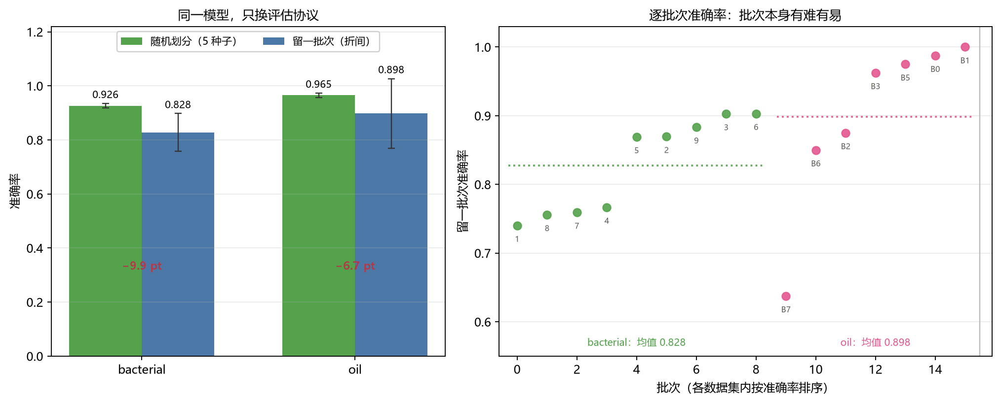

# 2026-11-19 · P18 论文图 1：双协议差距

## 目的

全文的起点。这张图要传达两件事：

1. **同一模型、同一数据，只换评估协议，准确率掉 7–10 个百分点**
2. **掉点不是划分运气**：种子的波动只有 ±1 pt，而批次本身的准确率分布在 0.63–0.99

## 结果

用项目管线（StandardScaler → SVC，无降维）现算，保证与全文其它数字同一来源：

| 数据集 | 随机划分（5 种子） | 留一批次（折间） | 差距 |
|---|---|---|---|
| 细菌（2710 条，6 类） | **0.926 ± 0.009** | **0.828 ± 0.070** | **−9.9 pt** |
| 油脂（560 条，8 类） | **0.966 ± 0.008** | **0.898 ± 0.129** | **−6.7 pt** |



## 逐批次准确率：批次本身有难有易

细菌 9 批：0.740–0.903（最易 3_Batch 0.903，最难 1_Batch 0.740）
油脂 7 批：0.634–0.992（最易 B1 0.992，最难 B7 0.634）

两个数据集的批次准确率都**横跨 25–35 个百分点**。这就是留批次协议标准差大
（0.07 / 0.13）的原因——不是噪声，是批次之间真实存在难度差异。

## 三个要点

**1. 差距与类别数无关。** 细菌 6 类掉 9.9 pt，油脂 8 类掉 6.7 pt——
类别多的油脂差距反而小，因为它的批次差异更温和（标准差 0.13 对 0.07 反着来：
油脂的折间波动更大但均值更高）。**决定差距的是批次间的分布差异，不是任务难度。**

**2. 五种子波动（±0.9 pt）与差距（6.7–9.9 pt）相差 8–11 倍。**
"高估"不是抽样噪声，是协议本身的结构性偏差。

**3. 右图是给读者看的"批次画像"。** 一眼可见最难批次（0.63）与最易批次（0.99）
差 36 个百分点——任何只报告单一数字的做法都掩盖了这个分布。

## 实现说明

- 折划分必须用 `group_split`（与 `group_cv_eval` 一致），自造划分会引入偏差（P16 的教训）。
- 随机划分用 `stratified_split`（按类别分层），与全文其它实验一致。
- 油脂留批次的标准差 0.129 明显大于细菌的 0.070，且样本量只有 392 条训练样本——
  折间波动大有小样本因素，判读时需注意。

## 局限

- 只测了一种模型（线性 SVM）。不同模型的协议差距可能不同，
  但 P5–P8 的证据表明其它方法只会更低。
- 随机划分的 5 个种子偏少，但波动已足够小（0.9 pt），增加种子不会改变结论。

## 命令

```bash
.venv/Scripts/python.exe 21_protocol_gap.py --no-show
```
